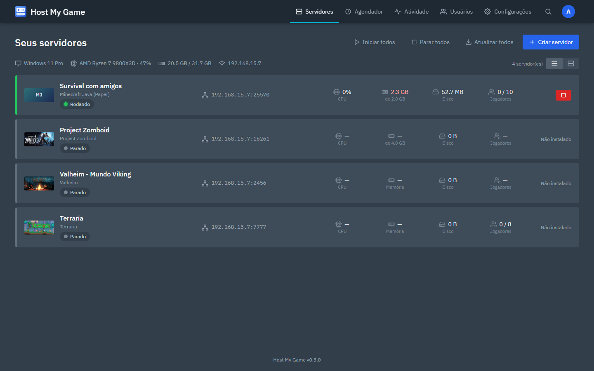
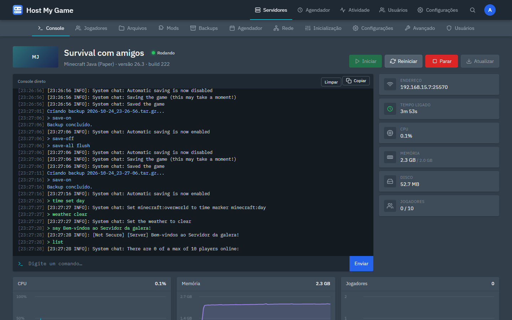
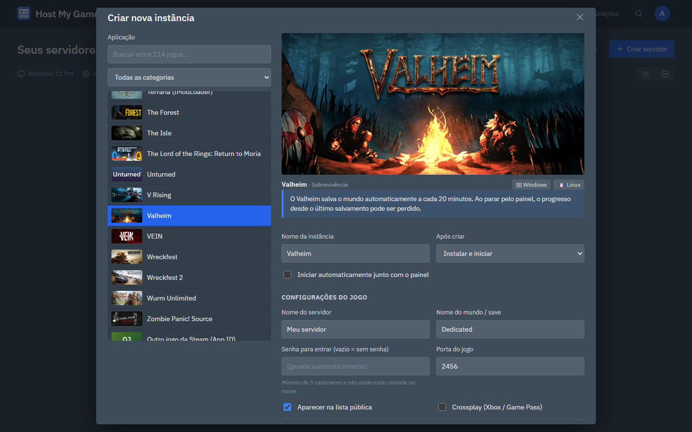
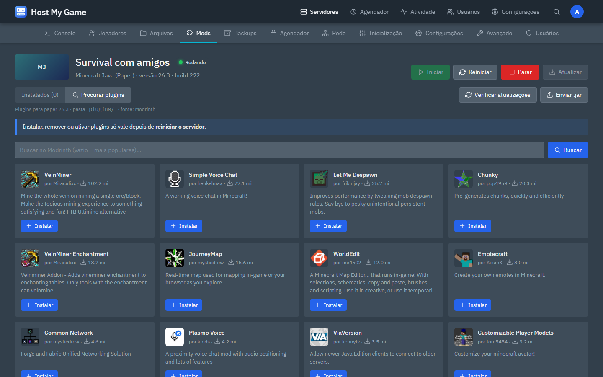
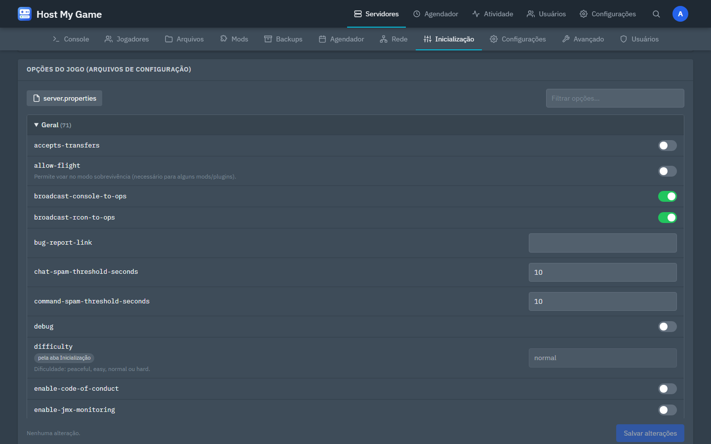
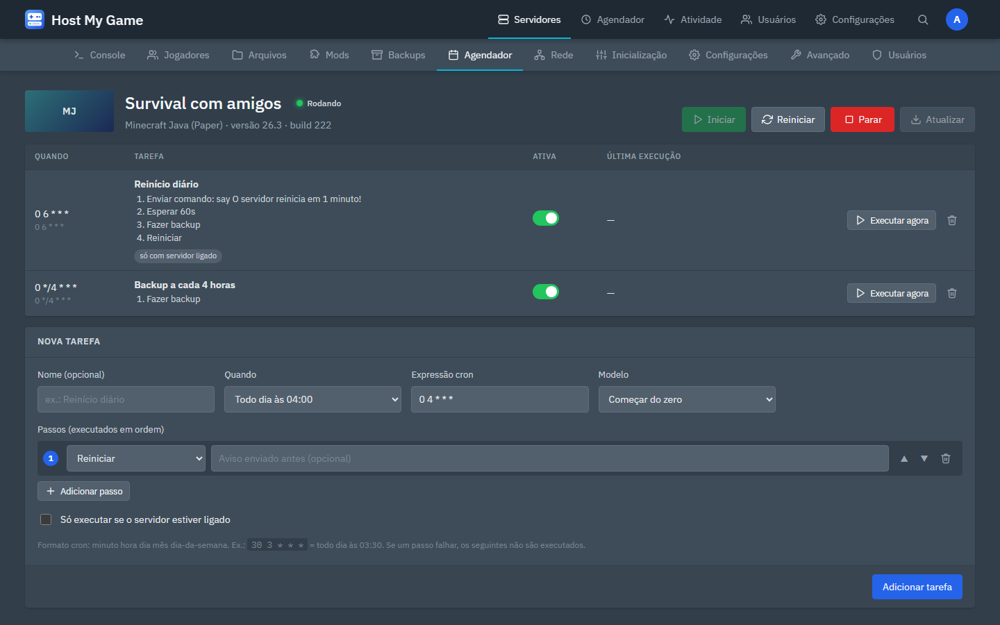
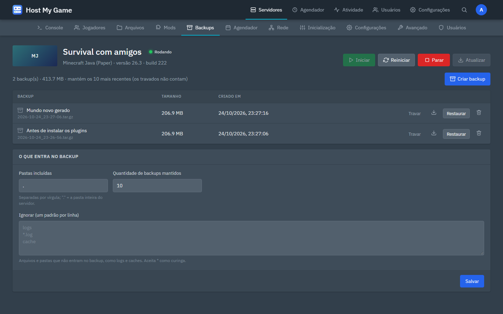
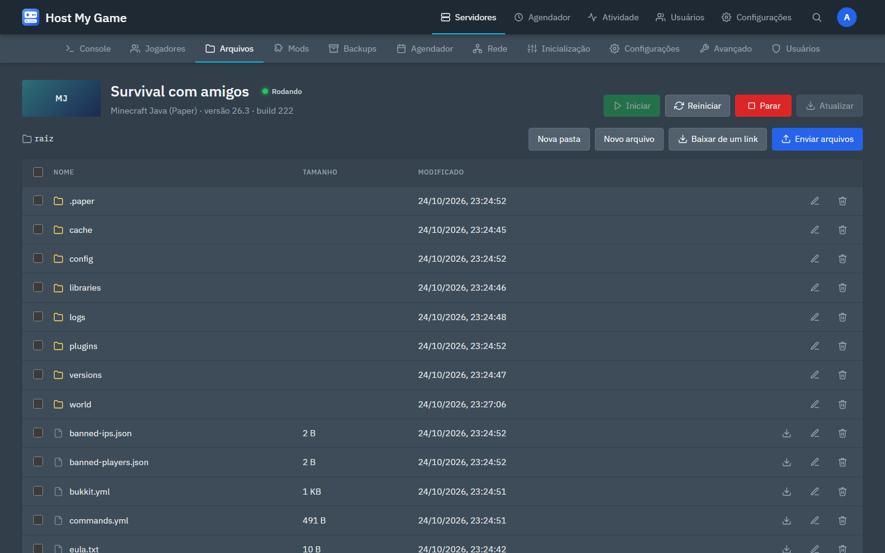
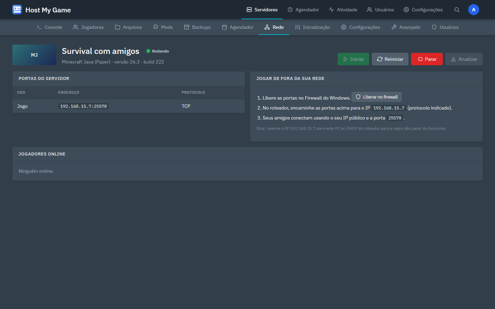
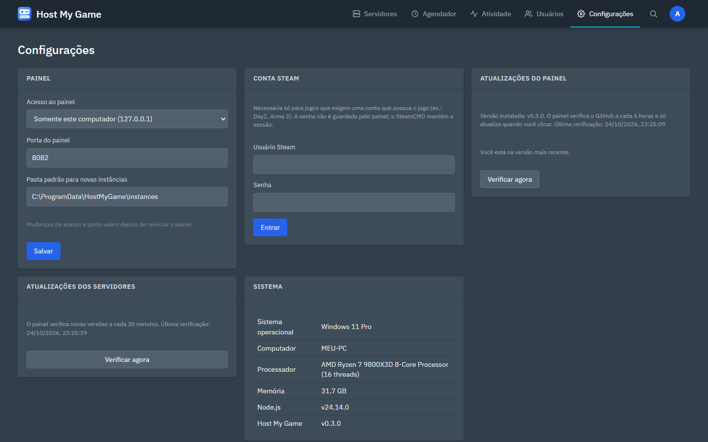

<p align="center">
  
</p>

<h1 align="center">Host My Game</h1>

<p align="center">
  Painel web para hospedar servidores de jogos no seu próprio PC, no estilo do AMP.<br>
  Instale, configure, acompanhe e atualize mais de 110 jogos pelo navegador, tudo em português.
</p>

<p align="center">
  <a href="https://github.com/MagroDaniel/HostMyGame/releases/latest"></a>
  <a href="https://github.com/MagroDaniel/HostMyGame/releases"></a>
  
  
</p>

<p align="center">
  <a href="https://github.com/MagroDaniel/HostMyGame/releases/latest"><b>⬇ Baixar o instalador</b></a>
  ·
  <a href="#tour-pelo-painel">Ver o painel</a>
  ·
  <a href="#jogos-suportados">Jogos suportados</a>
  ·
  <a href="#perguntas-frequentes">Perguntas frequentes</a>
  ·
  <a href="https://discord.gg/RQBnXJ8E8G"><b>💬 Entrar no Discord</b></a>
</p>



## Por que usar

- **Sem linha de comando.** Escolha o jogo, clique em criar e o painel baixa o servidor pela Steam (SteamCMD), pela Mojang ou pelo site oficial do jogo.
- **Tudo num lugar só.** Console ao vivo, arquivos, mods, backups, agendador, jogadores e portas, todos pelo navegador, inclusive do celular.
- **Cuida sozinho.** Reinicia o servidor se ele travar, avisa quando sai versão nova do jogo, faz backups no horário marcado e detecta problemas comuns no console.
- **Várias pessoas.** Contas com permissões por servidor, verificação em duas etapas e registro de quem fez o quê.
- **Atualiza pelo GitHub.** O painel avisa quando há versão nova e se atualiza com um clique.

## Instalar

1. Baixe o **`HostMyGame-Setup-<versão>.exe`** na [página de releases](https://github.com/MagroDaniel/HostMyGame/releases/latest).
2. Execute o instalador. Como ele não tem assinatura digital paga, o Windows pode mostrar "O Windows protegeu o computador". Nesse caso, clique em **Mais informações → Executar assim mesmo**.
3. No fim, deixe marcado **"Abrir o painel no navegador"** (ou abra http://localhost:8082).
4. No primeiro acesso, crie a conta de administrador.

O instalador já traz tudo o que precisa: não é preciso instalar Node.js nem Java. O painel roda como **serviço do Windows**, então liga junto com o computador, mesmo sem ninguém entrar na conta, e reinicia sozinho se cair.

| O quê | Onde fica |
|---|---|
| Programa | `C:\Program Files\HostMyGame` |
| Servidores, backups e contas | `C:\ProgramData\HostMyGame` |
| Logs do painel | `C:\ProgramData\HostMyGame\logs` |
| Atalhos | Menu Iniciar → Host My Game ("Abrir o painel" e "Pasta de dados") |

Atualizar ou reinstalar nunca mexe nos seus servidores. Ao desinstalar, o instalador pergunta se você quer apagar os dados; o padrão é manter.

## Tour pelo painel

### Console ao vivo e status
Envie comandos e veja a saída em tempo real. Ao lado aparecem endereço, tempo ligado, CPU, memória, disco e jogadores, com gráficos logo abaixo. O console funciona pela entrada padrão, por pseudoconsole, por RCON ou por Telnet, conforme o jogo.



### Criar um servidor
Busque entre mais de 110 jogos, ajuste nome, senha, portas e jogadores, e escolha o que fazer depois de criar: nada, só instalar, instalar e iniciar, ou instalar e manter sempre atualizado.



### Mods e plugins
No **Minecraft** (Fabric, Forge, NeoForge, Paper, Purpur e Velocity), busque no Modrinth já filtrado pela versão do servidor e instale com um clique; as dependências vêm junto. No **Project Zomboid**, procure na Oficina Steam, instale itens ou coleções inteiras e o painel preenche `WorkshopItems=`, `Mods=` e `Map=` sozinho.



### Opções do jogo sem editar arquivo na mão
Editor visual do `server.properties`, `servertest.ini` e `SandboxVars.lua`, com a explicação de cada opção, filtro e destaque do que mudou. Só as linhas alteradas são regravadas.



### Agendador
Cada tarefa tem vários passos em sequência, por exemplo avisar os jogadores, esperar 60 segundos, fazer backup e reiniciar. Tem modelos prontos, a opção "só se estiver ligado" e o botão "executar agora".



### Backups
Backups `.tar.gz` com descrição, restauração em um clique, limite de cópias, lista de exclusões (logs, cache) e a opção de travar um backup para ele nunca ser apagado. No Minecraft, o salvamento é pausado durante o backup.



### Arquivos
Navegue, edite, envie (inclusive arrastando), baixe, renomeie e exclua. Selecione vários para mover, copiar, compactar ou excluir de uma vez, descompacte `.zip` e baixe um arquivo direto de um link.



### Rede e acesso de fora
Lista das portas de cada servidor, aviso de conflito, liberação no Firewall do Windows com um clique e o passo a passo para os amigos entrarem de fora da sua rede.



### Configurações e atualizações do painel
Endereço e porta do painel, pasta padrão dos servidores, conta Steam (com login por QR code do app Steam) e o card de atualização do próprio painel.



## Jogos suportados

Mais de 110 jogos, com App IDs e executáveis da Steam conferidos no SteamCMD.

| Categoria | Jogos |
|---|---|
| **Minecraft** | Vanilla, Paper, Purpur, Fabric, Forge, NeoForge, Velocity e Bedrock |
| **Sobrevivência** | Valheim, Palworld, Enshrouded, 7 Days to Die, Project Zomboid, Rust, ARK (Evolved e Ascended), Conan Exiles, V Rising, Sons of the Forest, Core Keeper, DayZ e outros |
| **Tiro** | Counter-Strike 2, Arma 3, Arma Reforger, Squad, Insurgency: Sandstorm e outros |
| **Source** | Team Fortress 2, Garry's Mod, Left 4 Dead 1 e 2, CS:Source e outros |
| **Fora da Steam** | Terraria e Mindustry |
| **Qualquer outro** | Qualquer servidor da Steam pelo App ID (o executável é detectado sozinho) ou qualquer programa que você já tenha |

O Java é baixado automaticamente na versão certa para cada versão do Minecraft (Eclipse Temurin 8, 11, 17, 21 e 25).

## Todos os recursos

<details>
<summary><b>Servidores</b></summary>

- **Configurações do jogo** (nome, senha, portas, jogadores, mapa e outras). Antes de cada início, o painel aplica essas configurações nos argumentos e nos arquivos de configuração do próprio jogo.
- **Controle:** iniciar, parar (salvando quando o jogo permite), reiniciar, forçar parada e ações em massa (iniciar, parar ou atualizar todos).
- **Console ao vivo** pela entrada padrão, por pseudoconsole (para servidores que ignoram entrada redirecionada, como o Terraria), por RCON ou por Telnet. Para servidores que só escrevem em arquivo, o painel acompanha o log.
- **Status:** CPU e RAM somando todos os processos do servidor, jogadores online (consulta A2S da Steam, ping do Minecraft Java e Bedrock, ou leitura do log), tempo ligado e gráficos.
- **Atualizações dos jogos:** o painel verifica novas versões a cada 30 minutos, mostra "Atualização disponível" e oferece o botão "Atualizar".
- **Reinício automático** quando o servidor trava, com proteção contra loop.
- **Jogadores:** quem está online, expulsar, banir e dar admin. No Minecraft também whitelist, operadores e banidos (com o servidor desligado, o painel edita os arquivos e busca o UUID na Mojang). No Project Zomboid usa os comandos de admin do jogo.
- **Detecção de problemas:** o painel lê o console e avisa sobre EULA não aceito, versão errada do Java, porta em uso, falta de memória ou de disco, token GSLT e mods incompatíveis. EULA e Java são corrigidos com um clique.
- **Trocar tipo ou versão do Minecraft:** muda entre Vanilla, Paper, Purpur, Fabric, Forge e NeoForge, ou de versão, com backup completo antes. Mundo e configurações são mantidos.
- **Reinstalar** o servidor do zero, com backup antes.
- **Avançado:** sobrescrever executável, argumentos, modo do console, RCON, consulta, comandos de parada, branch beta da Steam e pasta de instalação.

</details>

<details>
<summary><b>Mods</b></summary>

- **Minecraft** (Fabric, Forge, NeoForge, Paper, Purpur, Velocity): busca no Modrinth filtrada pela versão do servidor, instalação com um clique (as dependências vêm junto), ativar/desativar, remover e atualizar. Jars enviados à mão também são reconhecidos.
- **Project Zomboid:** procure mods da Oficina Steam pelo nome (ou veja os mais inscritos e em alta), filtre por Build e clique em Instalar; vários cliques entram numa fila. Também dá para colar links de itens ou coleções inteiras. O painel baixa os itens, lê os Mod IDs e preenche `WorkshopItems=`, `Mods=` (no formato do Build 42) e `Map=` sozinho. Dá para ativar/desativar cada mod, mudar a ordem de carregamento e ver avisos de dependências faltando ou de mods feitos para outro Build.

</details>

<details>
<summary><b>Usuários e segurança</b></summary>

- **Usuários:** administradores e usuários com permissões por servidor (console, controle, atualizar, arquivos, backups, agendador e configurações).
- **Usuários por servidor:** na aba Usuários de cada servidor, o administrador dá acesso e escolhe as permissões de cada pessoa. Cada servidor mostra também a própria atividade recente.
- **Verificação em duas etapas** (Google Authenticator, Microsoft Authenticator etc.) com códigos de recuperação.
- **Esqueci minha senha:** recuperação pela tela de login com um código gravado no próprio PC do painel, sem precisar de e-mail.
- **Chaves de API** para bots e scripts (`Authorization: Bearer hmg_...`), com as mesmas permissões do dono da chave.
- **Registro de atividades:** quem fez o quê e quando.

</details>

<details>
<summary><b>Painel</b></summary>

- **Busca rápida** de servidores com `Ctrl+K`.
- **Conta Steam** para jogos que exigem login (DayZ, Arma 3, ACC e outros): entre **escaneando um QR code com o app Steam** ou com usuário e senha (código do Steam Guard ou aprovação no app). A sessão fica salva no PC, e esses jogos são baixados pelo [DepotDownloader](https://github.com/SteamRE/DepotDownloader).
- **Acesso pela rede:** por padrão o painel só aceita conexões deste computador; em Configurações dá para liberar para a rede local.
- **Atualização do próprio painel** pelo GitHub, sempre com a sua confirmação.

</details>

## Atualizações do painel

O painel consulta o GitHub a cada 6 horas. Quando sai uma versão nova, os administradores veem um aviso no topo da página. Em **Configurações → Atualizações do painel** aparecem as notas da versão e o botão **Atualizar**. Ao clicar, o painel:

1. baixa o instalador novo e confere o hash SHA-256 dele;
2. para os servidores de jogo com segurança;
3. instala a nova versão e reinicia o serviço;
4. recarrega a página sozinho quando volta, depois de mais ou menos um minuto.

Nada é atualizado sem você clicar. Rodando pelo código-fonte, o painel só mostra o link para baixar a versão nova.

## Jogar com amigos de fora da sua rede

1. Na aba **Rede** do servidor, clique em **Liberar no firewall**.
2. No roteador, encaminhe as portas do jogo (mostradas na aba Rede) para o IP local do seu PC.
3. Seus amigos conectam usando o seu IP público e a porta do jogo.

Dica: reserve o IP local do PC no DHCP do roteador, para a regra não parar de funcionar quando o IP mudar.

## Perguntas frequentes

<details>
<summary><b>Esqueci minha senha (ou o nome de usuário)</b></summary>

1. Na tela de login, clique em **Esqueci minha senha**.
2. No computador onde o painel está instalado, abra o arquivo `C:\ProgramData\HostMyGame\RECUPERAR-SENHA.txt` (atalho: Menu Iniciar → Host My Game → Pasta de dados). Ele tem um código e a lista de usuários do painel.
3. Digite o usuário, o código e a nova senha. Se você também perdeu o celular do autenticador, marque a opção para desativar a verificação em duas etapas.

O código vale por 15 minutos, aceita 5 tentativas e só funciona uma vez. Como ele só aparece no PC do painel, ninguém de fora consegue trocar a sua senha, mesmo que peça um código. Ao trocar a senha, todas as sessões abertas daquele usuário são encerradas. Quem não é administrador também pode pedir para um administrador redefinir a senha em **Usuários**.

</details>

<details>
<summary><b>O painel não abre em http://localhost:8082</b></summary>

- Confira se o serviço está rodando: abra `services.msc` e procure **Host My Game**. Ele deve estar "Em execução" com inicialização "Automática".
- Se você também roda o painel pelo código-fonte (`Iniciar painel.bat`), feche-o: os dois usam a porta 8082.
- Veja os logs em `C:\ProgramData\HostMyGame\logs`.

</details>

<details>
<summary><b>Como acessar o painel de outro computador ou do celular?</b></summary>

Em **Configurações → Painel**, mude "Acesso ao painel" para **Qualquer computador da rede (0.0.0.0)** e reinicie o painel (em `services.msc`, botão direito em Host My Game → Reiniciar). Depois acesse `http://<IP do PC>:8082`. O instalador já cria a regra de firewall do painel.

</details>

<details>
<summary><b>Parar o serviço desliga meus servidores?</b></summary>

Sim, mas com cuidado: o painel recebe o aviso de parada primeiro e manda cada servidor salvar e desligar, esperando até 2 minutos antes de encerrar à força. O mesmo acontece ao desligar o PC.

</details>

<details>
<summary><b>Valheim perdeu progresso ao parar</b></summary>

O Valheim não tem comando de parada pelo console, então o painel encerra o processo e pode perder o progresso desde o último salvamento automático, que acontece a cada 20 minutos. O Palworld salva pelo RCON antes de parar.

</details>

<details>
<summary><b>Posso usar junto com o AMP?</b></summary>

Pode. A porta padrão é 8082 justamente porque o AMP usa a 8081. Só não deixe os dois rodando servidores na mesma porta de jogo.

</details>

## Comunidade

Quer sugerir um recurso, reportar um bug, tirar uma dúvida ou só conversar com outras pessoas que usam o painel? Entre no [servidor do Discord](https://discord.gg/RQBnXJ8E8G): tem canais para anúncios de versões, sugestões, bugs e ajuda.

## Rodar pelo código-fonte

Requisito: Node.js 20.11 ou mais novo.

```
git clone https://github.com/MagroDaniel/HostMyGame.git
cd HostMyGame
npm install
npm start
```

Ou clique duas vezes em `Iniciar painel.bat`. Depois, abra http://localhost:8082.

Nesse modo, os dados ficam na pasta `data/` do projeto:

| Pasta / arquivo | Conteúdo |
|---|---|
| `panel.json` | Configurações, usuários e servidores |
| `instances/` | Servidores |
| `backups/` | Backups |
| `tools/` | SteamCMD e Java |
| `activity.log` | Registro de atividades |

As variáveis de ambiente `HOST`, `PORT` e `HMG_DATA_DIR` têm prioridade sobre o `panel.json`. O firewall automático só funciona com o painel rodando como administrador; sem isso, o painel mostra os comandos para você rodar. Na versão instalada, o serviço já tem essa permissão.

## Publicar uma versão nova

1. Mude `"version"` no [package.json](package.json) (ex.: `0.4.0`).
2. Faça o commit e crie a tag com o mesmo número: `git tag v0.4.0` e depois `git push origin main v0.4.0`.
3. O GitHub Actions ([release.yml](.github/workflows/release.yml)) gera o instalador e publica o release. Os painéis instalados passam a mostrar o aviso de atualização.

Para gerar o instalador no seu PC (precisa do [Inno Setup 6](https://jrsoftware.org/isdl.php)):

```
powershell -ExecutionPolicy Bypass -File installer\build.ps1 -Repo MagroDaniel/HostMyGame
```

O arquivo sai em `installer\build\`.

## Estrutura do projeto

```
src/                 servidor (Node.js + Express + WebSocket)
  providers/         SteamCMD, Minecraft, Java e downloads diretos
  mods/              Modrinth e Oficina Steam
  catalog.js         catálogo de jogos
  selfupdate.js      atualização do painel pelo GitHub
public/              interface web (JavaScript puro, sem build)
installer/           instalador (Inno Setup) e serviço do Windows (WinSW)
.github/workflows/   build e publicação dos releases
docs/screenshots/    imagens deste README
```

---

<p align="center"><sub>Feito para hospedar servidores em casa com o mínimo de dor de cabeça. Inspirado no AMP, mas escrito do zero, sem código do AMP.</sub></p>
